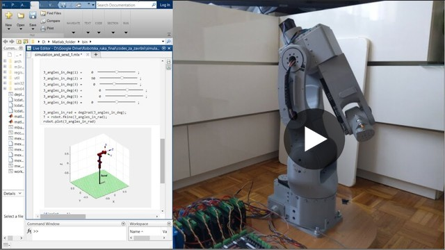

  

<h1 align="center">Faze4</h1>

  <b>Open-source, fully 3D-printable 6-axis robot arm.</b> 
  3D-printed cycloidal gearboxes with low backlash, and every wire hidden inside the arm, like an industrial robot.

  <a href="https://source-robotics.com/products/faze4-step-files"><b>STEP files</b></a>&nbsp;&nbsp;·&nbsp;&nbsp;
  <a href="https://faze4-robotic-arm-docs.readthedocs.io/en/latest/"><b>Documentation</b></a>&nbsp;&nbsp;·&nbsp;&nbsp;
  <a href="Assembly%20instructions%203.1.pdf"><b>Building instructions</b></a>&nbsp;&nbsp;·&nbsp;&nbsp;
  <a href="STL_V2.zip"><b>Print files</b></a>&nbsp;&nbsp;·&nbsp;&nbsp;
  <a href="https://discord.com/invite/prjUvjmGpZ"><b>Discord</b></a>

  
  

| **6 axes** | **14 to 15 kg** | **961 parts** | **1000 to 1500 USD** | **250 x 210 x 200 mm** |
|:-:|:-:|:-:|:-:|:-:|
| stepper motors | arm weight, about | 197 printed, 764 bought | total cost, about | print volume it needs |

## Project overview

<table>
  <tr>
    <td width="55%" valign="middle">
      Faze4 is a small, fully 3D-printable, open-source 6-axis robotic arm. It is functionally and aesthetically
      similar to robotic arms in industry, but it is aimed at research, education and anyone interested in making
      their own robot arm. What separates it from other DIY arms: its 3D-printed cycloidal gearboxes have low
      backlash and are easy to repair, and all its wires are hidden, which gives it a clean design.
        
      The whole arm has around 1000 parts, screws and bearings included, and weighs around 15 kg. A Teensy 3.5 runs
      the low-level control; the inverse kinematics and the simulations run in Matlab.
        
      <a href="https://youtu.be/ye37Mpj5qCQ"><b>&#9654;&#xFE0E;&nbsp; Watch Faze4 in action</b></a>
    </td>
    <td width="45%" valign="middle">
      
    </td>
  </tr>
</table>

## Start here

| I want to | Go to |
|---|---|
| **Build my own** | [building instructions](Assembly%20instructions%203.1.pdf) (PDF) · [BOM](BOM_7_11_2023.xlsx) · [print files](STL_V2.zip) · [printing tips](https://faze4-robotic-arm-docs.readthedocs.io/en/latest/D_Printing.html) · [cycloidal gearbox build video](https://www.youtube.com/watch?v=Ra8FxDiuQns) |
| **Wire the electronics** | [electronics guide](https://faze4-robotic-arm-docs.readthedocs.io/en/latest/Electronics_PCB.html) · [distribution board V2](Faze4_DIST_board_v2_files/) · [board test codes](FAZE4_distribution_board_test_codes/) |
| **Program it** | [low-level code](https://faze4-robotic-arm-docs.readthedocs.io/en/latest/F_Code.html) (Teensy 3.5) · [high-level code](https://faze4-robotic-arm-docs.readthedocs.io/en/latest/G_Code2.html) (Matlab) · [the code](Software1/) |
| **Simulate it** | [URDF files](URDF_FAZE4/) · [work envelope](Faze4_Work_Envelope.m) (Matlab) |
| **Change the parts in CAD** | [FAZE4 STEP files](https://source-robotics.com/products/faze4-step-files), every part, from the shop · [cycloidal disc STEP files](cyclo_disk_STEP_files.zip) |
| **Look up the robot data** | [dimensions, reduction ratios and belts](https://faze4-robotic-arm-docs.readthedocs.io/en/latest/I_Robot_data.html) |

The building instructions cover the mechanical assembly; the [documentation](https://faze4-robotic-arm-docs.readthedocs.io/en/latest/)
has everything else: the electrical wiring, the low-level setup, the high-level code in ROS and Matlab, and tips. You
need both to build the arm.

## In this repository

| File or folder | What is in it |
|---|---|
| [`Assembly instructions 3.1.pdf`](Assembly%20instructions%203.1.pdf) | the building instructions for the mechanical assembly |
| [`BOM_7_11_2023.xlsx`](BOM_7_11_2023.xlsx) | the bill of materials: screws, bearings, motors, belts and every printed part; some links are affiliate links |
| [`STL_V2.zip`](STL_V2.zip) | every printed part (version 2), by section from the base to the wrist, with the cosmetic lids |
| [`cyclo_disk_STEP_files.zip`](cyclo_disk_STEP_files.zip) | the 11:1, 15:1 and 27:1 cycloidal discs as STEP files |
| [`Faze4_DIST_board_v2_files`](Faze4_DIST_board_v2_files/) | the distribution board V2: schematic, board dimensions and a STEP model |
| [`FAZE4_distribution_board_test_codes`](FAZE4_distribution_board_test_codes/) | test sketches for the V2 board: the pins, the OLED display and a stepper move |
| [`Distribution_PCB.zip`](Distribution_PCB.zip) | the first distribution board (V1, not recommended): Gerbers, BOM, drawings and STEP files |
| [`FAZE4 Robotic arm electronics setup.pdf`](FAZE4%20Robotic%20arm%20electronics%20setup.pdf) | how the arm is wired, for the V1 board |
| [`Software1`](Software1/) | the Matlab code (a slider GUI, the kinematic model, trajectory planning) and the Teensy sketches it talks to |
| [`Faze4_test_code_1.0`](Faze4_test_code_1.0/) | the first test sketch, a serial-monitor stepper controller for an STM32 Blue Pill |
| [`URDF_FAZE4`](URDF_FAZE4/) | the URDF model, with ROS launch files for RViz and Gazebo |
| [`Faze4_Work_Envelope.m`](Faze4_Work_Envelope.m) | a Matlab script that plots the work envelope |
| [`docs`](docs/) | the Sphinx sources of the documentation (the site on Read the Docs is built from the `dev` branch) |

## Community

Ask in [Discussions](https://github.com/orgs/Source-Robotics/discussions), chat on
[Discord](https://discord.com/invite/prjUvjmGpZ), report a bug in
[Issues](https://github.com/Source-Robotics/Faze4-Robotic-arm/issues), and follow Source Robotics:

## Safety, liability and disclaimer

This project includes experimental software, hardware designs, and assembly documentation that are still under development and may contain bugs, errors, or incomplete features.
By using, building, or modifying this project, you acknowledge and agree that:
* You use this project entirely at your own risk
* You are solely responsible for safe assembly, testing, and operation
* No guarantee is made regarding correctness, safety, or reliability
* The authors are not responsible for any damage, injury, or loss resulting from the use or misuse of this project
* Hardware performance and safety depend on user assembly, component quality, calibration, and handling, which cannot be guaranteed

This project is provided “as is.” If you choose to build a device yourself using these files, designs, or instructions, you do so without any warranties or guarantees, including regarding safety, reliability, or suitability for any particular purpose.

## Licensing

Project is under the [CERN Open Hardware Licence Version 2 - Strongly Reciprocal](LICENSE) (CERN-OHL-S-2.0). Until 24 September 2025 it was under MIT.
